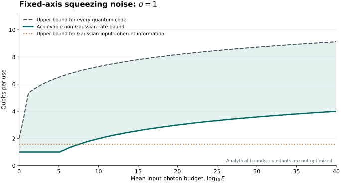

# Bosonic Squeezing Capacity

**How much quantum information can extra oscillator energy protect against a fluctuating squeezing drive?** For independent, unobserved Gaussian squeezing along a known axis, quantum capacity is unbounded but grows only as the double logarithm of the input photon budget.

For every fixed noise width $`\sigma>0`$, the ordinary unassisted capacity satisfies

```math
\boxed{\displaystyle
Q_\sigma(E)=\log_2\!\ln E+O_\sigma(1),
\qquad E\to\infty.}
```

The input constraint is an unconditional mean photon budget across the complete coding block. The upper bound covers arbitrary encoders, nonuniform energy allocation, unbounded photon-number tails, and collective decoding. A finite-energy non-Gaussian input construction attains the same leading coefficient.

## What the result establishes

| Result | Consequence |
| --- | --- |
| [Matching capacity bounds](science/01-model.md#principal-result) | A fixed-strength squeezing channel has an unbounded double-logarithmic energy-capacity regime. |
| [Finite-energy log-position subspaces](science/02-achievability.md) | Increasing the number of orthogonal input modes keeps environmental entropy bounded while growing the achievable rate. |
| [Arbitrary-block converse](science/03-converse.md) | High-frequency encodings and correlations between uses cannot improve the leading growth law. |
| [Bounded Gaussian-input coherent information](science/05-gaussian-inputs.md) | Even correlated Gaussian physical inputs have a bounded benchmark at fixed noise strength; non-Gaussian input families eventually exceed it. |
| [Inherited protected qubit](science/04-protected-qubit.md) | A quadrature-sign/parity subsystem preserves one logical qubit exactly with one mean input photon in the ideal model. |

The protected subsystem, random-squeezing model, and logarithmic-coordinate reduction have prior sources. The new account supplies the matched harmonic-energy capacity law and its Gaussian-input comparison; [related work](science/06-related-work.md) separates these contributions and dependencies.



The figure evaluates analytical bounds at $`\sigma=1`$. Its shaded region brackets the capacity; neither curve is an exact finite-energy capacity evaluation. The constants and sampled bandwidth choices are not optimized, so the horizontal scale is not a practical crossover prediction. [Data and reproduction](verification/README.md).

## Read the argument

Start with the [scientific route](science/README.md) and [model](science/01-model.md). The main proof combines [achievability](science/02-achievability.md) with the [spectral-bin and heat-trace converse](science/03-converse.md). The [Gaussian-input proof](science/05-gaussian-inputs.md) explains the role of non-Gaussian states, and the [interpretation](science/07-interpretation.md) connects the rate to oscillator energy and the fluctuating drive.

The [reference guide](references/README.md) identifies primary sources. The [LLM reading guide](llms.txt) maps questions to authoritative proofs. The [verification guide](verification/README.md) gives runnable checks and their limits.

## Scope

The squeezing axis and Gaussian law are known, each use has a fresh unobserved draw, and no correction occurs inside a channel use. The channel includes no photon loss or additional phase or displacement noise. The high-energy limit keeps $`\sigma>0`$ fixed.

The fluctuating drive increases mean harmonic energy by the factor $`e^{2\sigma^2}`$. Counting this supplied energy preserves the leading law at fixed variance. Preparation complexity, recovery work, finite-block errors, and robustness to other noise are separate questions.

The Gaussian restriction concerns the physical input states in a coherent-information optimization. It is not a universal claim about circuits that contain Gaussian components.

## Purpose and contact

This repository serves as a record of the work and a guide for the author’s self-directed learning. For discussion or potential collaboration, please contact Ruge Lin at [gogoko699@gmail.com](mailto:gogoko699@gmail.com).
